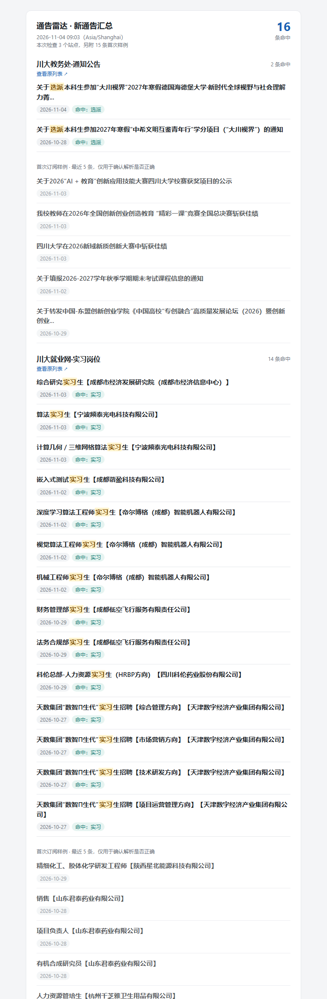

# notice-radar

**Keyword-filtered notice monitor for university websites — daily email digest, zero server.**

Repo: [Mengysheng/gain-message](https://github.com/Mengysheng/gain-message) · 中文文档：[README.md](README.md)

Many Chinese universities publish scholarships, exchange programs and internship openings on
plain notice boards with no RSS feed. Missing a three-day application window is easy.

`notice-radar` watches those list pages, extracts each notice, filters by keywords, deduplicates
against what you have already seen, and mails you a digest.



## Why not a generic page-change monitor?

Tools like changedetection.io alert on *any* page change: visit counters, timestamps, carousels.
Notice boards also repeat the same item on the home page, list page and detail page. This project
works **per item** instead: parse the list → dedupe by link and title → keyword match → alert only
on genuinely new entries.

## Features

- Per-item parsing with plain CSS selectors — no headless browser needed
- Keyword rules: any-of, all-of, exclusions, regex; title-only or title + body
- Deduplication across runs, persisted in a JSON state file
- HTML + plain-text email digest with keyword highlighting, grouped by site
- First-run sample so you can verify the selectors actually work
- Parsing failures trigger an alert email instead of failing silently
- `doctor` health check and `inspect` selector detection
- Offline `demo` command — clone and see the output without configuring anything
- Runs free on GitHub Actions, commits its own state back to the repo

## Quick start

Requires Node.js ≥ 20.

```bash
npm ci
node src/cli.js demo        # offline demo, no network, no email
node src/cli.js inspect "https://your-university.edu.cn/notice-list.htm"
node src/cli.js doctor
```

Copy `config.example.yaml` to `config.yaml`, paste the selectors `inspect` suggested, add your
SMTP credentials as environment variables, then:

```bash
node src/cli.js run
```

Deployment, SMTP setup and troubleshooting are documented in Chinese in
[README.md](README.md), [docs/selector.md](docs/selector.md) and [docs/deploy.md](docs/deploy.md).

## Commands

| Command | Purpose |
|---|---|
| `node src/cli.js doctor` | check config, selectors, date coverage, optionally SMTP |
| `node src/cli.js inspect <url>` | suggest selectors for a new site |
| `node src/cli.js demo` | offline end-to-end demo |
| `node src/cli.js test` | parse and print, no state change, no email |
| `node src/cli.js run` | fetch → match → email → save state |

## License

MIT. Use it for personal information gathering only, respect each site's robots.txt and terms,
keep the polling interval reasonable.
