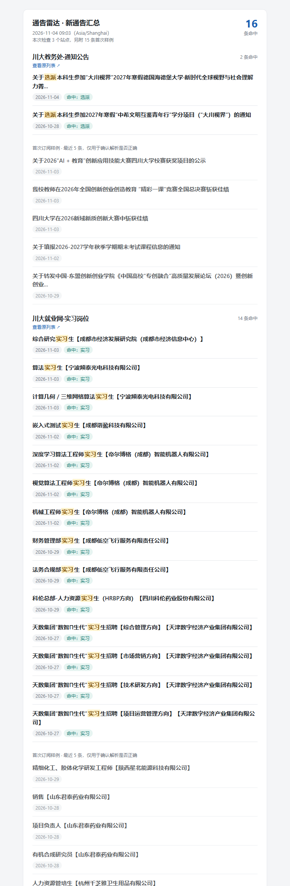

# 通告雷达 notice-radar

按关键词盯着学校官网 / 教务处 / 研究生院 / 学院公告栏，**只把命中关键词的新通告**汇总成一封邮件发给你。不用登录学校门户，不用装浏览器插件，跑在 GitHub Actions 上零成本。



典型场景：

- 盯「推免 / 保研 / 夏令营 / 预推免」，不漏报名窗口
- 盯「奖学金 / 助学金 / 评优」，不错过材料提交时间
- 盯「选课 / 退课 / 考试 / 四六级」，按时办事
- 一个学校多个栏目（教务处 + 学院 + 研究生院），一次配好全盯

---

## 它和现成工具有什么区别

现成的网页监控（[changedetection.io](https://changedetection.io)、Distill、Visualping 等）解决的是「**页面变了就通知**」，放到学校通告上有三个坑：

1. 访问量、时间戳、轮播图一动就告警，噪音大；
2. 同一条通告在首页 / 列表页 / 详情页重复出现，会推好几次；
3. 不区分「新通告」和「旧通告」，也没法只推关键词相关的那几条。

这个脚本换成「**按条目**」处理：解析列表 → 按链接去重 → 关键词匹配 → 只推真正的新增条目，并附上日期、命中词和链接。逻辑很简单，但正好是学校通告需要的。

---

## 3 分钟本地跑起来

需要 Node.js ≥ 20（`node -v` 检查）。

```bash
npm install
node src/cli.js test        # 只解析、只打印，不发邮件、不改状态
```

看到类似输出就说明通了：

```
== 川大教务处·通知公告 ==
   https://jwc.scu.edu.cn/ssjgy.jsp?wbtreeid=1001
   解析 13 条，命中 2 条
   ✓ 2026-11-04  关于选派本科生参加“大川视界”2027年寒假德国海德堡大学…
      命中：选派

== 川大就业网·实习岗位 ==
   解析 20 条，命中 14 条
   ✓ 2026-11-03  算法实习生【宁波频泰光电科技有限公司】
      命中：实习
```

当前 `config.yaml` 里配的就是这三个四川大学的栏目，可以直接用；换成你自己的学校时，把 `sites:` 换掉即可。

然后配置邮箱（见下一节），跑一次真实的：

```bash
node --env-file-if-exists=.env src/cli.js run
```

想先看看邮件长什么样、但不想发信：

```bash
node src/cli.js run --dry-run --no-email --preview out/preview.html
```

用浏览器打开 `out/preview.html` 即可。

---

## 加自己的学校

### 第 1 步：找到「列表页」

不是首页，而是**只列通告的那个页面**，比如：

- 教务处 → 通知公告
- 研究生院 → 招生信息
- 学院 → 新闻动态 / 通知公告

### 第 2 步：自动探测选择器

```bash
node src/cli.js inspect "https://你的学校/通知列表页"
```

输出会直接给出可以粘贴的配置：

```
1. 命中 14 条，带日期 100%
   list:
     item: "table.wp_article_list_table tr"
     title: "a"
     link: "a"
     date: "td.ti"
   示例：关于2026年新生自查核实学信网学籍信息的通知
```

把这几行贴进 `config.yaml` 的 `sites:` 里，改个 `name`，再跑 `node src/cli.js test` 验证。

### 第 3 步：微调（如果自动探测不准）

| 现象 | 怎么改 |
|---|---|
| 混进了导航链接 | 把 `item` 写得更具体，加上外层容器，如 `div.news-list li` |
| 条目数对但日期为空 | 看页面日期在哪个标签里，填 `date: "span.time"`；实在没有就删掉这行，脚本会从整条文字里猜 |
| 标题带了日期或前缀 | 一般不影响匹配；也可以在 `title` 里指定更内层的 `a` |
| 抓不到内容 / 乱码 | 加 `charset: gbk`（老站点常见） |
| 需要请求头 | `headers: { Referer: "https://..." }` |

选择器就是 CSS 选择器，浏览器 F12 → 右键元素 → Copy → Copy selector 也能拿到。

---

## 配置关键词

```yaml
keywords:
  include: [推免, 保研, 夏令营, 预推免]   # 命中任意一个就推
  exclude: [招聘, 招标, 中标]            # 命中就丢弃
  include_mode: any                      # any=任一；all=必须全中
  match_in: title                        # title=只看标题；title+content=连正文
```

- 普通词是**子串匹配**，自动忽略大小写、全角半角差异，`推免` 也能匹配 `推免生`。
- 想精确控制用 `regex`，和 `include` 是「或」关系。
- 每个站点还可以写自己的 `keywords:`，会**叠加**在全局规则上（适合「教务处只关心教学，学院只关心讲座」）。

> 建议：`include` 从宽（先看几天有没有漏），再用 `exclude` 收窄噪音。

---

## 配置邮箱

脚本用 SMTP 发信，QQ / 163 / 企业邮箱都行。**密码必须用「授权码」，不是登录密码。**

<details>
<summary>QQ 邮箱：开启 SMTP 并拿授权码</summary>

1. 网页版 QQ 邮箱 → 设置 → 账号
2. 找到「POP3/IMAP/SMTP/Exchange/CardDAV/CalDAV 服务」
3. 开启「SMTP 服务」，按提示验证后拿到一串授权码
4. 配置：`smtp.qq.com` / `465` / `secure: true`
</details>

<details>
<summary>163 邮箱</summary>

`smtp.163.com` / `465` / `secure: true`，同样在设置里开启 SMTP 并获取授权码。
</details>

密码不要写进 `config.yaml`，用环境变量：

```bash
# PowerShell（当前窗口有效）
$env:SMTP_HOST="smtp.qq.com"
$env:SMTP_PORT="465"
$env:SMTP_SECURE="true"
$env:SMTP_USER="you@qq.com"
$env:SMTP_PASS="授权码"
$env:MAIL_TO="you@qq.com"

node src/cli.js check-smtp    # 先验证能不能登录
node src/cli.js run           # 真正跑一次
```

或者把 `.env.example` 复制成 `.env` 填好，用 `node --env-file-if-exists=.env src/cli.js run`。
`.env` 已经在 `.gitignore` 里，不会被提交。

---

## 放到 GitHub Actions 上（推荐）

跑在 GitHub 的机器上，电脑关机也能收邮件，公开仓库完全免费。

1. **新建一个仓库**（Private 更稳妥），把本目录代码推上去。
2. 仓库 **Settings → Secrets and variables → Actions → New repository secret**，依次添加：

   | Name | 值 |
   |---|---|
   | `SMTP_HOST` | `smtp.qq.com` |
   | `SMTP_PORT` | `465` |
   | `SMTP_SECURE` | `true` |
   | `SMTP_USER` | 你的邮箱 |
   | `SMTP_PASS` | 授权码 |
   | `MAIL_TO` | 收件邮箱（多个用逗号分隔） |

3. **Actions** 页面 → 左侧 `notice-radar` → `Run workflow` 手动跑一次。
4. 第一次运行会给每个站点发一封「订阅成功 + 最近几条样例」的邮件，用来确认解析正确；之后只推新增的命中条目。

默认时间（`.github/workflows/radar.yml`，注意 GitHub 用 UTC）：

```yaml
- cron: '0 0 * * *'    # 08:00 北京
- cron: '0 4 * * *'    # 12:00 北京
- cron: '0 11 * * *'   # 19:00 北京
```

只想要工作日：`'0 0 * * 1-5'`。

**两个关键点：**

- 工作流需要 `permissions: contents: write`，每次跑完把 `state/state.json` 提交回仓库，否则下次会当成全新，重复推送。
- 定时任务在整点高峰可能延迟 5～15 分钟，正常现象。

> Fork 别人的仓库时，Actions 默认是关闭的，而且 Secrets 不会跟着 fork 过去，需要自己重新加。

---

## 命令

| 命令 | 作用 |
|---|---|
| `node src/cli.js inspect <url>` | 探测列表页选择器，配置新站点用 |
| `node src/cli.js test` | 只解析、打印，不改状态不发信（`--site 名称` 只测某站） |
| `node src/cli.js run` | 正式检查 → 匹配 → 发邮件 → 存状态 |
| `node src/cli.js run --dry-run` | 预览会推什么，不发信、不存状态 |
| `node src/cli.js run --no-email` | 只写 Markdown 汇总 |
| `node src/cli.js run --init` | 把当前列表全部标记为已读（想从零开始） |
| `node src/cli.js check-smtp` | 验证 SMTP 能否登录 |
| `npm test` | 跑单元测试（27 个，覆盖匹配/去重/日期/解析） |

`run` 的其它开关：`--no-export`、`--strict`（抓取失败时退出码 2）、`--verbose`、`--config 路径`、`--preview 文件`。

---

## 输出

- **邮件**：一封汇总，命中条目高亮关键词，附日期和链接；`email.mode: per_item` 可改成一条一封。
- **Markdown**：`out/latest.md` 始终是最新一份，`out/archive/` 按时间存档，方便直接贴进 Notion / Obsidian。
- **退出码**：`0` 正常，`2` 有站点抓取失败（配合 `--strict` 让 Actions 变红，避免静默失效）。

---

## 主要配置项

| 字段 | 说明 | 默认 |
|---|---|---|
| `timezone` | 邮件和文件时间用的时区 | `Asia/Shanghai` |
| `state_file` | 去重状态文件 | `state/state.json` |
| `retention_days` | 状态保留天数 | `120` |
| `request.timeout` / `retries` / `concurrency` | 抓取超时、重试、并发 | `20000` / `2` / `3` |
| `keywords.include` / `exclude` / `regex` | 关键词规则 | 空 |
| `keywords.include_mode` | `any` 或 `all` | `any` |
| `keywords.match_in` | `title` 或 `title+content` | `title` |
| `sites[].url` / `sites[].urls` | 列表页，多个页面用 `urls` 数组 | — |
| `sites[].list.item` | 每条通告的选择器 | — |
| `sites[].list.title` / `link` / `date` | 条内标题、链接、日期的选择器 | `a` / `a` / — |
| `sites[].detail.enabled` | 是否抓详情页正文（摘要 / 正文匹配） | `false` |
| `sites[].detail.content` | 详情页正文选择器 | — |
| `sites[].max_items` | 每个站点最多取多少条 | `40` |
| `first_run.mode` | `digest` 发样例 / `silent` 静默 | `digest` |
| `email.mode` | `digest` 汇总 / `per_item` 逐条 | `digest` |
| `email.send_on_error` | 抓取失败也发提醒 | `true` |
| `export.enabled` | 是否写 Markdown | `true` |

---

## 常见问题

**解析到 0 条**

先 `inspect` 看有没有候选。都没有的话：页面可能是 JS 动态渲染（右键查看源代码，搜索通知标题，搜不到就是），或者需要登录学校门户。前者可以换一个静态栏目（很多学校「信息公开」「新闻网」是静态的），后者本脚本不处理登录。

**详情页正文只有「加载中，请稍后」**

说明详情页是 JS 渲染的，`detail` 抓不到正文，但不影响标题级匹配。需要正文级匹配就得上 Playwright，属于另一个量级的改动。

**中文乱码**

加 `charset: gbk`。脚本默认会读 `Content-Type` 和 `<meta charset>` 自动判断，少数站点两者都不写。

**邮件收不到**

按顺序排查：`check-smtp` 能否登录 → 垃圾箱 → `MAIL_TO` 是否填对 → QQ 邮箱用的是不是授权码 → 收件人是否把发件人拉黑。

**同一站点重复推送**

看 Actions 的「提交去重状态」那一步有没有成功。没有 `contents: write` 权限时，`state/` 推不回仓库，每次都是新状态。

**站点改版，选择器失效**

脚本会在邮件里报「有 N 个站点没抓到内容」，用 `inspect` 重新生成选择器即可。建议把 `--strict` 留着，让 Actions 直接变红。

**运行太频繁会不会被封**

默认每天 3 次、每站 1～2 个请求（+ 命中条目最多 10 个详情页），频率远低于正常浏览，基本不会触发风控。真遇到 403，先加 `headers`（Referer / Cookie），再考虑降频。

---

## 目录结构

```
config.yaml              配置文件（站点 + 关键词 + 邮件）
src/cli.js               命令行入口与主流程
src/fetch.js             抓取（重试、超时、GBK 自动识别）
src/parse.js             列表/详情解析
src/match.js             关键词匹配与高亮
src/store.js             去重状态
src/mail.js              邮件渲染与发送
src/export.js            Markdown 汇总
src/inspect.js           选择器探测
test/                    单元测试
.github/workflows/       GitHub Actions 定时任务
out/                     Markdown 汇总（自动生成）
state/                   去重状态（自动生成，需要提交）
```

---

## 已知限制

- 不处理登录态（统一身份认证后的内网通知），也不破解验证码。
- 详情页 JS 渲染的站点拿不到正文，只能标题匹配。
- 依赖页面结构，改版后需要重新 `inspect`（会有报错邮件提醒，不会静默失效）。

MIT License
